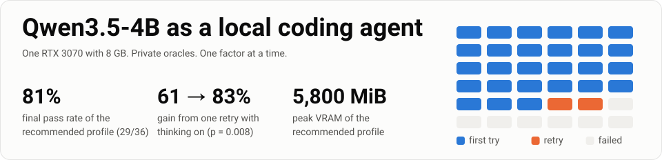
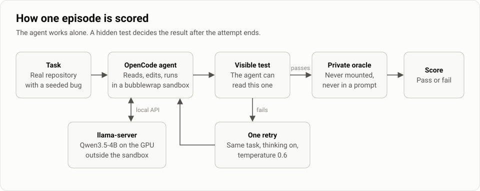
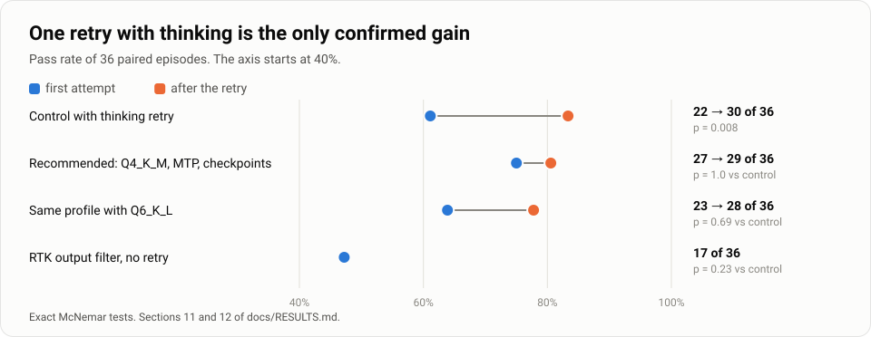
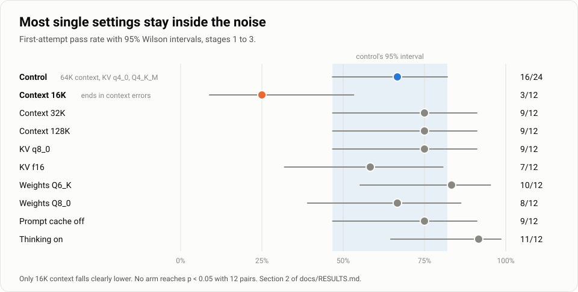
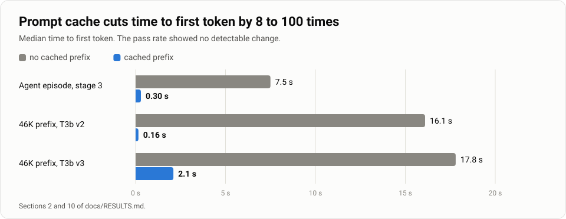
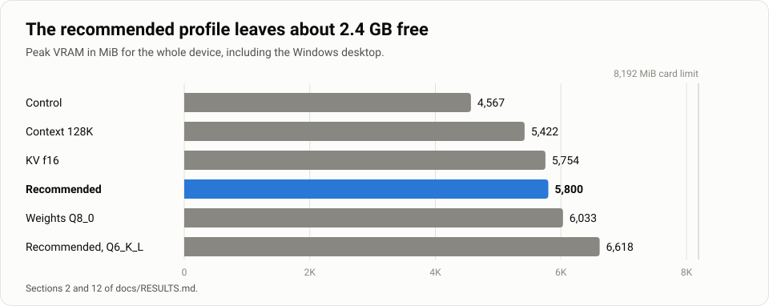
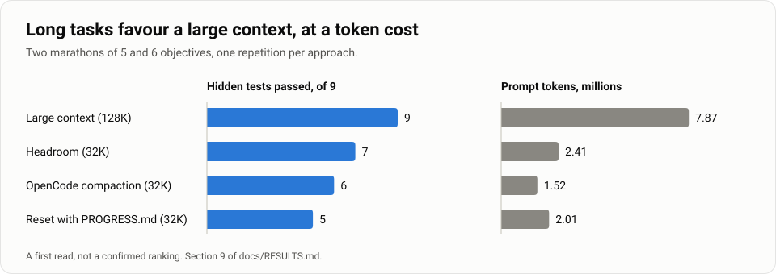
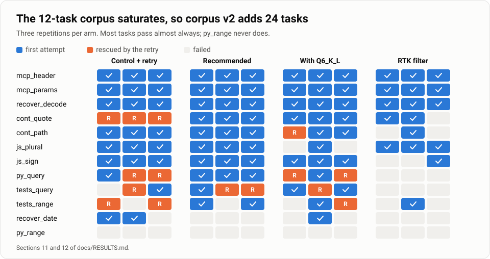

A coding agent is a program that reads a codebase, edits files and runs commands to finish a task on its own. Most of them depend on large cloud models. This repository tests how far one can go with a small model running at home, on a single 8 GB graphics card.

We give the agent real bugs to fix in two open-source projects and check each fix with tests it never sees. Then we change one setting, run everything again and compare pass rate, time and video memory.

## Results so far

The setup we recommend fixed 29 of 36 task attempts (81%) and peaked at 5,800 MiB of video memory.

- Retrying a failed attempt once, with the model's thinking mode on, raised one setup from 22 to 30 passes out of 36. This is the only statistically significant gain so far (p = 0.008).
- A 16K context window passed 3 of 12 attempts. At 32K and above, passes stayed between 67% and 75%.
- The prompt cache made the first token arrive 8 to 100 times sooner.
- Higher-precision weights, a larger KV cache and the RTK output filter showed no measurable benefit.

These numbers come from one machine and 12 tasks, so treat them as early results. The [limitations](#limitations) section lists what they cannot show.

To run this yourself, start at [Recommended setup](#recommended-setup). The method is in [How it works](#how-it-works), and every table is in [docs/RESULTS.md](docs/RESULTS.md).

## How it works



- **Tasks.** The results below use 12 pilot tasks in 6 classes: Python fixes, JavaScript fixes, writing tests, two-phase continuation, stubbed tool use, and tool recovery. They run on snapshots of [Bottle](https://github.com/bottlepy/bottle) and [ms](https://github.com/vercel/ms).
- **Scoring.** A private oracle runs once at the end of each attempt. It is never mounted in the sandbox and never appears in a prompt, so the agent cannot fit its answer to the test.
- **Isolation.** OpenCode runs in bubblewrap, without access to the repository, `/mnt/d`, `/home`, or the oracles.
- **Comparison.** Early stages change one factor from a control. Later campaigns replicate promising results and combine them. We report 95% Wilson intervals and exact, paired McNemar tests.

The retry runs only when the visible test or the agent fails. An attempt that passes the visible test and fails the oracle is not retried.

Read more: [methodology](docs/METHODOLOGY.md) · [machine and versions](docs/HARDWARE.md) · [every table](docs/RESULTS.md).

## Findings

### 1. Retry once with thinking on



Thinking on for every attempt costs about 3.3 times more time, and its early lead did not repeat (11/12, then 16/24). Using it only after a failure gives most of the benefit at a much lower cost: 8 of 10 retries succeeded, and no first-attempt success was lost.

Across the original stage 5 and its replication, the cascade rose from 29/48 to 41/48.

The recommended profile starts stronger and needs fewer retries (3 instead of 10). Its 29/36 is not different from the control's 30/36 (p = 1.0).

### 2. Most single settings stay inside the noise



With 12 tasks, small effects cannot be separated from chance. Only 16K context clearly fails: nine of its twelve episodes ended in a CLI error, and the stage 2 report records the context limit being exceeded. The other differences are signals, not a ranking.

### 3. Keep the prompt cache on



Without the cache, median episode time rises from 42 s to 115 s. With it, a repository prefix of about 46K tokens becomes usable on the 3070. The prefix improved latency only: all three T3b v3 arms passed the same 2 of 12 tasks. The bottleneck there is the edit protocol, because the 4B writes the SEARCH block from memory instead of copying it.

### 4. 8 GB is enough



Q6_K_L used 818 MiB more than Q4_K_M and finished at 28/36 against 29/36, so the extra precision did not pay for itself here.

### 5. Long tasks favour a large context



If the task fits in VRAM, keeping the whole history won. If context must be limited, Headroom did better than native compaction or a reset. This campaign has one repetition per arm, and instrumentation does not confirm that compaction finished, so a replication is planned.

### 6. The corpus is now the main limit



Most of the pilot tasks pass almost every time and `py_range` never does, so few tasks can separate one configuration from another. Corpus v2 adds 24 tasks, which are written and validated but not yet calibrated.

## Recommended setup

| Setting | Use | Why |
| --- | --- | --- |
| Weights | Q4_K_M | Q6 variants showed no significant gain and use more VRAM |
| Context | 64K (32K minimum) | 16K fails with OpenCode on this corpus |
| KV cache | q4_0 | No measurable loss, lowest VRAM |
| Prompt cache | On, `--cache-ram 2048` | 25 times lower latency; the 8 GiB default caused a WSL out-of-memory stop |
| Thinking | Off, then on for one retry | 22/36 → 30/36 (p = 0.008) |
| Server | MTP and context checkpoints | 74 → 115 tok/s decode; 37 → 25 s success time, measured separately in stage 4 |
| Sampling | Temperature 0, retry at 0.6 | Qwen's recommended sampling scored 6/12 |
| OpenCode steps | 40 | 80 steps scored 10/12, with no clear gain |
| RTK | Off | 17/36 against 22/36 (p = 0.23), no evidence to adopt it |
| LSP | Not needed | Neutral, and the model never called the `lsp` tool on its own |

MTP, checkpoints, and the 2 GiB cache limit were enabled together in the combined campaign, so that campaign cannot attribute its result to any one of them. The limit's effect on results is unknown.

### Server

Replace `<models>` with the directory containing the GGUF.

```sh
llama-server \
  --model <models>/Qwen_Qwen3.5-4B-Q4_K_M.gguf \
  --host 127.0.0.1 --port 8080 --alias local-qwen \
  --ctx-size 65536 --parallel 1 -ngl 99 \
  --fit off --flash-attn on \
  --cache-type-k q4_0 --cache-type-v q4_0 \
  --jinja --reasoning off \
  --chat-template-kwargs '{"enable_thinking": false}' \
  --temp 0 --top-p 0.95 --top-k 20 \
  --cache-prompt --no-webui \
  --spec-type draft-mtp --spec-draft-n-max 2 \
  --ctx-checkpoints 64 --checkpoint-min-step 1024 \
  --cache-ram 2048
```

<details>
<summary><strong>OpenCode profile</strong></summary>

Thinking is off on the server. The 40 steps and temperature 0 are in the model profile.

```json
{
  "autoupdate": false,
  "model": "local/local-qwen",
  "subagent_depth": 0,
  "provider": {
    "local": {
      "npm": "@ai-sdk/openai-compatible",
      "name": "Local llama.cpp",
      "options": {
        "baseURL": "http://127.0.0.1:8080/v1",
        "apiKey": "local"
      },
      "models": {
        "local-qwen": {
          "name": "local-qwen",
          "limit": { "context": 65536, "output": 8192 },
          "options": { "temperature": 0 }
        }
      }
    }
  },
  "agent": {
    "build": { "mode": "primary", "steps": 40 }
  }
}
```

</details>

<details>
<summary><strong>Escalating with thinking</strong></summary>

The benchmark runner escalates automatically when an attempt fails the visible test. In manual use, start a second server or restart the same one with these options:

```sh
--reasoning on \
--chat-template-kwargs '{"enable_thinking": true}' \
--temp 0.6 --top-p 0.95 --top-k 20
```

In the OpenCode profile, also use `"options": { "temperature": 0.6, "topP": 0.95, "topK": 20 }`.

</details>

## Next steps

| When | Work |
| --- | --- |
| Now | Calibrate the 24 new tasks and keep those that pass 20% to 80% of the time |
| Soon | Compare the recommended profile with the control on the calibrated corpus; separate the effects of MTP, checkpoints, and the cache limit; retest on the latest llama.cpp |
| Later | Replicate long tasks with three repetitions; try a new edit protocol for the bounded worker; compare ExLlamaV3 and a large model on the same corpus |
| Eventually | Build a separate confirmation set; add new host repositories; evaluate new small models; work through the remaining backlog |

<details>
<summary><strong>Backlog</strong></summary>

- **P2:** mistral.rs with the same GGUF; bounded worker at scale; native Windows llama.cpp versus WSL2; rebuild with GGML_CUDA_FA_QUANTS for mixed KV.
- **P3, outside the 4B scope:** vLLM or LMDeploy with AWQ and GPTQ-Marlin; offload of MoE larger than VRAM; models from 7 to 14B; agent LoRA.

</details>

## Reproduce

**You need:** Windows with WSL2 (Ubuntu 24.04) and an 8 GB NVIDIA GPU, plus Python 3.12 with pytest and ruff. We tested with an RTX 3070, driver 610.62, CUDA Toolkit 13.0, pytest 9.1.1, and ruff 0.17.3 ([details](docs/HARDWARE.md)). Binaries and weights are not in the repository: `benchmark/configs/qwen-4b-opencode-baseline.json` lists the paths and SHA-256 hashes for llama.cpp v0.8.0, OpenCode 1.19.5, Node, bubblewrap, and the GGUF files.

Without a GPU, from the repository root:

```sh
export PYTHONDONTWRITEBYTECODE=1
PY=python3   # use the Python 3.12 validation environment
$PY -m pytest -p no:cacheprovider -q                  # 20 test files, see Limitations
$PY -m benchmark.opencode_baseline --dry-run          # lists the 300 units of the current protocol
$PY -m benchmark.opencode_baseline --dry-run --arm B0 # 24 units
PYTHONDONTWRITEBYTECODE=1 $PY corpus/validate_corpus.py --node /path/to/node   # 36/36 PASS, a few minutes
```

With a GPU (run only when it is free; the runner refuses to start if a `llama-server` is already active):

```sh
$PY -m benchmark.opencode_baseline --smoke                  # 1 episode: B0, task py_query
$PY -m benchmark.opencode_baseline --smoke --task cont_path # another task
$PY -m benchmark.opencode_baseline --arm B-kv8              # one arm
$PY -m benchmark.opencode_baseline --stage N                # every unit of stage N (N from 1 to 4)
```

The current protocol writes to `results/qwen-4b-opencode-baseline-bwrap-v7`, because the config is already the stage 4 v7 revision. To reproduce stages 1 through 3, use the v5 and v6 configs from earlier commits (the last commit before the refactoring is `c2cf750`). The runner refuses to mix results with different manifests.

Reports and figures:

```sh
$PY -m benchmark.baseline_report DIR_v5 DIR_v6 \
  --markdown report.md --csv report.csv \
  --control-dir DIR_v5 --control B0
$PY docs/figures/build_figures.py
```

Generated aggregates are in [results/3070-benchmark/](results/3070-benchmark/). Raw results (workspaces, logs, and JSON per attempt) stay outside the repository.

<details>
<summary><strong>Repository structure</strong></summary>

```
README.md
docs/
  METHODOLOGY.md          method: corpus, oracle, isolation, counting, classification
  HARDWARE.md             machine, versions, weights and storage
  RESULTS.md              every table: per arm, per task, paired and configuration
  RENAMES.md              old Portuguese paths mapped to their English names
  figures/                README figures and the script that builds them
  restricted-python-v2.md, methodology/pristine-grading-protocol.md
                          documentation of retained code (removal candidates)
benchmark/
  opencode_baseline.py    baseline runner: protocol, manifest, isolation and oracle
  baseline_report.py      offline report: Wilson, McNemar, timings, TTFT and VRAM
  baseline_stage5.py      stage 5, replication and combined runner (--config)
  worker_contract.py, worker_runner.py, guarded_edit.py
                          bounded worker contract and runner; not evaluated in this baseline
  harness_runner.py, harness_eval.py, pristine_grading.py, restricted_python.py,
  run_observer.py, provenance.py, resource_sampler.py, safe_execution_guard.py
                          dependencies imported by the runner
  configs/                current protocols and harness profiles (OpenCode, Pi, Vibe)
  fixtures/               six task fixtures used by the harness and the grader
  eval_suites/            behavior probes for the fixtures
corpus/                   36 tasks: hosts (Bottle 0.13.2 and ms 2.1.3), tasks, oracles,
                          stubs, support, prefixes and hash manifest
tests/                    20 test files for the retained modules
results/3070-benchmark/   aggregates for stages 1 to 5, replication, combined campaign, T2 and T3b
reports/                  F0, F1, F3 and T1 reports, copied without logs or snapshots
```

</details>

## Limitations

Read every number here as a measurement of one machine on a small development corpus. The results have not been tested on a separate confirmation set.

<details>
<summary><strong>Full list</strong></summary>

- **Small, saturated corpus.** There are 12 pilot tasks. Eight almost always pass; py_range never passed. Many arms have only 12 episodes, and comparisons with 36 episodes still have little power for small differences.
- **Pilot corpus.** The results use the original 12 tasks, which were not calibrated with the model and are not a confirmation set. Corpus v2 adds 24 tasks (36 in total) that still await calibration. `bottle.py` has about 51 thousand tokens, estimated from character count.
- **Significance.** The thinking cascade in the stage 5 replication is the only new comparison with a significant result. In the 16K arm, with 5 losses and no wins, p = 0.0625 is the smallest possible value with five discordant pairs in the same direction.
- **Different quantizers.** The control uses bartowski Q4_K_M. Q6_K and Q8_0 are from unsloth, and unsloth Q4_K_M only appears in stage 4.
- **Storage.** Q6_K and Q8_0 GGUF files are read from `/mnt/d` (D: drive). The laboratory rule requires WSL ext4. The effect on metrics was not measured.
- **Sandbox.** OpenCode execution permits networking, and bash confinement has not been proven for all commands. Current evaluations use a separate sandbox without networking; historical results were produced with earlier versions.
- **Device VRAM.** VRAM is sampled for the whole device at about 1 Hz, and the Windows desktop shares the GPU. It is not exclusive process memory.
- **Proxy TTFT.** TTFT measures time until the first content, reasoning, or tool call, as seen by the local proxy. It may be unavailable for some requests.
- **Combined factors.** MTP, checkpoints, and the 2 GiB RAM cache limit were enabled together. The reference arm used the default 8 GiB RAM cache, so the isolated effect of the limit is unknown.
- **Missing fields in v5 and v6 results.** Automatic termination taxonomy and diff quality metrics (lines, scope, weakened tests) were added later. Results for stages 1 through 3 have these fields empty or null. Failure causes come from `failure` labels recorded by the runner.
- **Infrastructure retries.** Two v6 units had their first attempt invalidated by grader failure. The second attempt, which passed, counted as a pass. This follows the protocol. In v5, a model failure was classified as infrastructure and retried; this classification was corrected in v6.
- **Timeouts in stages 4 and 5.** Nine final results and two intermediate attempts also recorded a connection reset. Current rules would prioritize the server error, but logs do not prove whether the reset preceded the timeout, so historical numbers were retained. See the [revalidation](reports/strategy-analysis-4b-2026-10-28/execution/F1/pr45-review-fixes.md).
- **Unequal repetitions.** Many exploratory arms in stages 4 and 5 have 12 episodes. The replicated cascade and combined campaign have 36 episodes per arm. T2 still has one repetition per arm, and its conclusion about compaction does not confirm that compaction finished.
- **T3b.** The 4B writes the SEARCH block from memory and resubmits rejected edits. OpenSSL errors affected v2 and v3 verification, so historical passes do not isolate the context effect. Excluding `js_sign` from P-W16 due to a proven verifier failure leaves that arm at 2/11, and other episodes also received environmental diagnoses, so the quality comparison is inconclusive. See the [revalidation](reports/strategy-analysis-4b-2026-10-28/execution/F1/pr45-review-fixes.md).
- **Landlock on drvfs.** The historical T3b run used a repository copy on WSL ext4. The revised verifier was also tested on `/mnt/d`.
- **Reproduction on another machine.** The config has laboratory paths and SHA-256 hashes. A different machine requires a new `protocol_id`, because the manifest refuses to mix protocols.

</details>

## History

Campaigns before 2026-10-28 were removed from this tree. They remain in git history through commit `c2cf750` of `refactor/3070-benchmark` and its predecessors. The refactoring pull request lists what was removed and why. Reports written before the translation are mapped in [docs/RENAMES.md](docs/RENAMES.md).
